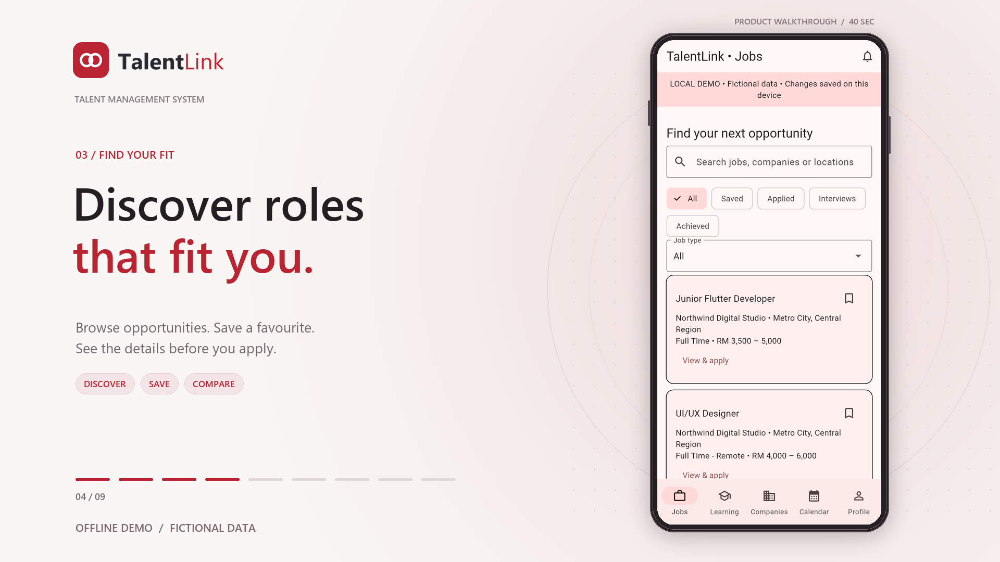

# TalentLink

A Flutter job and talent management app that runs **entirely offline** on
fictional sample data. TalentLink is a portfolio demo: it is not affiliated with
any company, and all names, jobs, courses and people in it are invented.

It is a portfolio piece derived from my experience on a commercial talent-management
project. All client-specific code, branding, backend integration and data have been
removed or replaced; this repository contains none of the client's material.

## App preview

[](teaser/output/talentlink-teaser-40s.mp4)

**[Watch the 40-second trailer](teaser/output/talentlink-teaser-40s.mp4)**
| [View poster](teaser/output/talentlink-teaser-poster.png)

A 1080p walkthrough of registration, login, job discovery, applications,
training enrolment and career profiles, captured from the real app.
See the [teaser production notes](teaser/README.md) for reproduction steps and credits.

## Features

- Register and sign in with a local account, or use the sample login
  `demo@talentlink.example` / `Demo123!`.
- Save jobs, apply, withdraw, and simulate interview invitations and offers.
- Enrol in training or webinars; sessions appear in the calendar.
- Add and delete calendar events, edit your profile, create/edit/delete text résumés,
  view a sample appraisal, and change your local password.
- Accounts and activity persist on the device. Passwords are salted and hashed.
- Clearing app data removes everything. No data is ever sent to a server.

## Run

```sh
flutter pub get
flutter run
flutter test
```

Use invented personal details and passwords.
